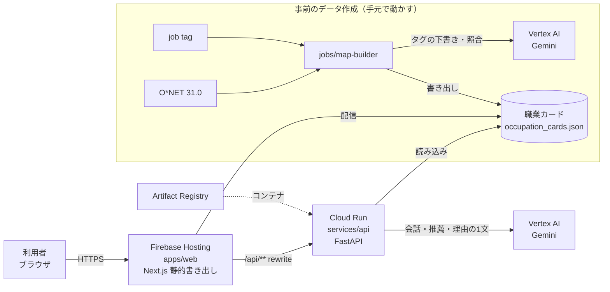

# アーキテクチャ

## 全体像

## コンポーネント

| ディレクトリ | 役割 | 技術 | 実行環境 |
|---|---|---|---|
| `apps/web` | 画面（ホームの「自分のこと → 会話 → 職業カード」、仕事の街 `/map`、業界ページ `/map/[slug]`） | Next.js（静的書き出し）・React・PixiJS（仕事の街） | Firebase Hosting |
| `services/api` | 公開 API。会話（`/api/chat`）・職業の推薦（`/api/recommend`）・理由の1文（`/api/reasons`） | Python・FastAPI・Google Gen AI SDK | Cloud Run（サービス `api`、asia-northeast1） |
| `jobs/map-builder` | job tag と O*NET から職業カードのデータ（`occupation_cards.json`）を作る。タグ・距離・つながりの1文は Gemini の下書き | Python・Google Gen AI SDK | 手元 |

デプロイの手順と今の設定は [deploy.md](deploy.md) にある。

## 設計の約束

- **会話を保存しない**：データベースは使わない。画面が毎回、これまでの会話（見せた仕事と反応を含む）をまとめて API に送る。選んだタグと結果は、ページを開いている間だけ画面のメモリに持つ（仕事の街で「出会った仕事」だけは、ブラウザの localStorage に残す）
- **職業カードのデータは1つのファイル**：map-builder が書き出した `apps/web/public/data/occupation_cards.json` を、画面と API の両方が読む。手で直さない
- **仕事の街と業界ページはビルドのときに作る**：職業カードと、業界・分野の振り分け（`apps/web/data/industryOccupations.json`・`industryFields.json`）から作り、API は使わない
- **AI の出力を確かめる**：会話と推薦で返ってきた職業 ID は、API が職業データの一覧と照らす
- **Gemini が使えなくても動く**：会話は職業データと決まった問いで、職業カードはデータでの選び方（`pickCards`）で最後まで進む
- **鍵を作らない**：Cloud Run はサービスアカウントで、手元は ADC で Vertex AI を呼ぶ。API キーやサービスアカウントの鍵は作らない
- **同一オリジン**：Hosting の `/api/**` を Cloud Run の `api` に rewrite するので、API のパスは `/api` から始める

## 職業データ

- 元データ：厚生労働省 職業情報提供サイト（job tag）の「職業情報データベース」（解説系 ver.7.01・簡易版数値系 ver.7.00）の556職業と、O*NET 31.0 の職業のうち job tag にない444職業
- 1MB を超えるので、元の CSV と途中の生成物はコミットせず `.data/` に置く。手順は `jobs/map-builder/README.md`
- 画面と提出物に出典を表示する（加工した旨を含む）。job tag の写真・動画は使わない
